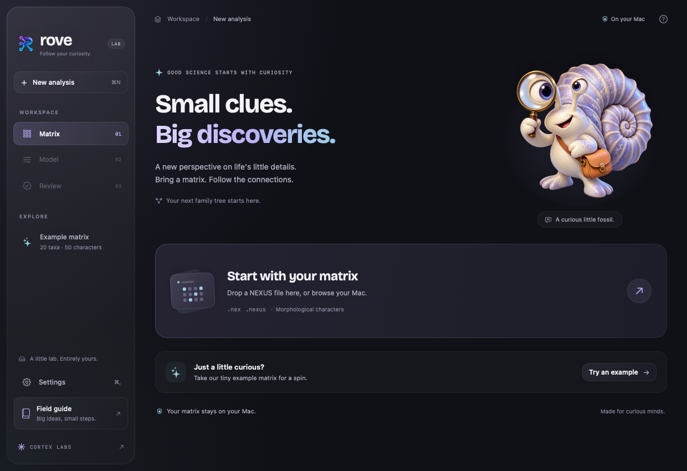

<p align="center">
  
</p>

<h1 align="center">Rove</h1>

<p align="center">Explore evolutionary paths.</p>

<p align="center"><a href="https://rove.getcortexlabs.com/">Website</a> · <a href="https://github.com/getcortexlabs/rove">GitHub</a></p>

Rove is an ARM-first phylogenetic inference project written in Rust, starting
with a likelihood kernel for morphological data. The name comes from exploring,
wandering, and discovering paths.

The crate computes tree likelihoods and samples trees under binary morphological
models without depending on BEAST. Broader model support remains future work.
BEAST is a reference for validation and benchmarking. Optional BEAST 2 and BEAGLE
integration remains a possible compatibility path.

## Status

Early. The likelihood core with its direct Mk path and a NEON kernel for it,
the Mkv correction, the morphological NEXUS reader, pattern compression,
numerical tests and a standalone binary-character sampler are implemented.
The supplied reference model runs with four gamma categories and a lognormal
relaxed clock. Posterior summaries and clade frequencies agree with BEAST 2.7.8
under predeclared criteria in six constructed 20-taxon cases. Optional integrations
remain pending. Work is tracked in the
[issues](https://github.com/getcortexlabs/rove/issues).

## Native Mac preview

The first SwiftUI/AppKit workspace imports matrices through Rust, displays their
characters and runs analyses with live progress and cancellation. It uses a glass sidebar, a fossil
explorer and the Cortex Labs typography. Settings supports English, Brazilian
Portuguese and preferences for reduced motion and transparency.



```sh
scripts/build-macos.sh
open build/macos/Rove.app
```

Requires macOS 14+, Xcode with Swift 6, and Rust. This builds a local app; a
notarized release and DMG are future work. Review the model and explicit group
constraints, start the bundled Rust engine, and inspect trace and tree files.
Choose an optional outgroup without removing any terminals; review the applied
groups before starting. Saved setups preserve that choice and can be reopened
after their matrix fingerprint is checked.
History keeps previous runs accessible across launches, with their settings,
outcomes and output files, and can prepare a new run from a saved configuration.
Completed runs can produce an annotated MCC tree for FigTree, with explicit
burn-in and a choice of common ancestor or sampled heights. Open saved summaries
in the native tree explorer to inspect nodes, search taxa, rotate or collapse
clades and export an SVG figure. Original samples stay unchanged. Completion and node support do not establish convergence; resumed
runs remain future work. Diagnostics show recorded parameters, trace plots, ESS
and equal-tailed intervals with an adjustable burn-in; calculations stay in Rust.
See the [Mac guide](docs/guide/macos-preview.md) and [build notes](apps/macos/README.md).

## People

Rove began with conversations between Rafael Augusto and **Thiago J. Silva**,
the biologist whose questions about phylogenetic analysis set the project in motion.
Thiago works alongside Rafael on the project, bringing the biological perspective,
testing analyses and discussing what the results mean.

## Why

- Small state spaces and short morphological alignments are worth measuring
  as their own workload, including the cost of setup and partial updates.
- Mk has a closed form, `P(t) = e*I + (1-e)*pi`, which permits an O(k) child
  update per pattern instead of a full O(k^2) matrix multiplication. Rove's
  Mk core prunes with it directly.
- ARM-specific vectorisation and reuse of repeated calculations are candidate
  optimisations. Their value needs to be established with matched benchmarks.

The first [BEAST 2.7.8 reference experiment](benchmarks/beast-2.7.8/2026-10-25/README.md)
records the exact model, runtime, sampling diagnostics, and fixed numerical
states for a selected 20 x 50 dataset. It used BEAST's Java likelihood core.
No controlled cross-engine benchmark has been run yet.

The [Rust baseline on Apple M4 Max](benchmarks/rove/2026-10-26/README.md)
measures 11 workloads, separating setup, full evaluations, partial updates and
proposal bookkeeping. It includes raw samples and the variation between runs.
The [direct Mk comparison](benchmarks/rove/2026-10-28/README.md) measures both
pruning paths in the same processes: the matrix path took 1.25 times as long as
the closed form for a full evaluation of the reference dataset, and 2.66 times
as long with eight states. The [NEON comparison](benchmarks/neon/2026-10-28/README.md)
measures both backends the same way: the portable code took 1.48 times as long
as the NEON kernel for a full evaluation of the reference dataset, and sampler
runs with the portable code took 1.08 to 1.11 times as long as with NEON.

With the [Mkv correction](docs/guide/kernel.md#conditioning-on-variable-characters),
Rove reproduces the likelihood of both archived BEAST states for the reference
dataset, pattern by pattern.

## Design

- Pattern-major layout: one contiguous array per state per rate category, so
  the inner loop vectorises across site patterns, not states. Works for k=2
  as well as k=61.
- Model-aware fast paths. Mk prunes through its closed form; other models can
  pass full transition matrices.
- NEON first, AVX2 second. On aarch64 a NEON kernel runs the Mk node update;
  the portable code runs everywhere else, is its reference and gives the same
  results. There is no AVX2 path yet.
- One crate today. Optional BEAGLE C ABI and BEAST 2 JNI adapters are planned;
  neither is required by the Rust core.

## Non-goals

Competing with BEAGLE's CUDA backend on large nucleotide alignments. Use the
GPU for that.

## Fixtures

`fixtures/synthetic/control_20x50.nex` is a positive control: 20 taxa, 50 binary
characters, no homoplasy, no missing data, known tree. `tools/synth_matrix.py`
regenerates it and produces degraded variants. See `fixtures/synthetic/README.md`.

The separately supplied [reference dataset](fixtures/reference/20x50/README.md)
includes its BEAST 2 XML and provenance. Do not substitute one fixture for the
other when reproducing a result.

Independent chains now run in parallel with `rove sample --chains 2` or `--chains 4`.
The native app offers 1, 2 or 4 chains, progress per chain, saved group history,
R-hat, per-chain ESS and clade-frequency comparisons. Each chain keeps its own
trace and tree files. Optional scalar diagnostic stopping is off by default;
it does not certify topology convergence. See the [sampler guide](https://rove.getcortexlabs.com/guide/sampler).


## Roadmap

1. Establish the scalar core, tests, CI and BEAST reference. Done.
2. Read morphological NEXUS and compress observed patterns. Done.
3. Record the Rust kernel baseline and add the Mkv correction. Done.
4. Add direct Mk pruning, measuring the change. Done.
5. Build a minimal standalone MCMC. Done.
6. Add NEON where profiles of complete runs show kernel time. Done.
7. Add the relaxed-clock reference model and check its components. Done.
8. Validate complete inference on known matrices. Done for six 20-taxon cases.
9. Evaluate relaxed-clock proposals. Done; classical defaults retained.
10. Run independent chains in parallel and compare them. Done.
11. Add checkpoints and rescale by powers of two.
12. Partition characters by number of states, condition on
    parsimony-informative characters and support ordered characters.
13. Add marginal likelihoods, the fossilized birth–death prior with tip dates
    and posterior predictive checks.
14. Evaluate subtree repeats.
15. Consider optional BEAST 2 JNI and BEAGLE C ABI adapters.

## Sampling trees

```sh
cargo run --release --bin rove -- sample fixtures/reference/20x50/matrix.nex \
  --output runs/seed-1 --seed 1 --steps 10000000 --sample-every 1000 \
  --monophyly T1,T2,T3,T4,T5,T6,T7,T8,T9,T10,T11,T12,T13,T14,T15,T16,T17,T18,T19
```

The sampler supports one partition of binary characters under Mk or Mkv,
a strict clock with rate 1 and the birth–death tree prior, with monophyly
constraints. Add `--model reference` for the supplied XML's four gamma categories
and explicit lognormal relaxed clock. Its [model guide](docs/guide/reference-model.md)
records every parameter, the numerical checks and the differences from ORC's
sampling proposals. The [sampling guide](docs/guide/sampler.md)
describes the model, the output files and the checks. With the strict-clock model, the same moves and
fixed steps as BEAST 2.7.8, its posterior means and clade frequencies on the
reference matrix met criteria fixed before the runs
([report](benchmarks/strict-clock/2026-10-28/README.md)). The
[full-model comparison](benchmarks/inference/2026-10-29/README.md) covers the supplied
matrix, a separate known-tree control and three degradation cases. It records
concordance, convergence, runtime and ESS per second with the original ORC
proposals in BEAST and the current Rove moves.

The [joint-proposal study](benchmarks/sampling/2026-10-29/README.md) evaluates
optional coupled height/rate and sigma/rate moves against that baseline. All
six cases pass the scientific criteria. The combined schedule improves the
aggregate posterior/sigma ESS-per-second score, but regressions in gamma
shape and Mkv birth–death density keep it opt-in. The default is unchanged;
the report includes every parameter, uncertainty intervals and reproduction
commands.

## Reading a matrix

```sh
cargo run --release --example read_nexus -- fixtures/reference/20x50/matrix.nex
```

The reference matrix produces 23 observed patterns with a total weight of 50.
The [NEXUS guide](docs/guide/nexus.md) defines the supported syntax, gap policy,
uncertainty and polymorphism handling, and partition-aware compression.

## Website

The documentation site at [rove.getcortexlabs.com](https://rove.getcortexlabs.com/) uses VitePress, in English, Portuguese, Spanish and Chinese. It documents what the crate does today; planned work is on its roadmap page.

```sh
npm ci
npm run docs:dev
```

Build with `npm run docs:build`; preview the build with `npm run docs:preview`.

## License

MIT or Apache-2.0, at your option.
